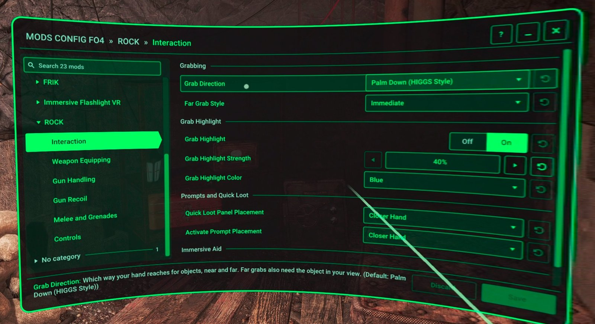

# ROCK User Guide

ROCK gives you physical hands in Fallout 4 VR. They collide with the world, pick things up, pull them from a distance, hold weapons by their grips, and use grenades and aid items by hand.

### [Install](../README.md#install) · [Changelog](../CHANGELOG.md) · [Nexus Mods](https://www.nexusmods.com/fallout4/mods/108881) · [Demo Video](https://www.youtube.com/watch?v=tPaIzmZ9P0o&t=113s) · [For Mod Authors](api/Overview.md)

### Contents

- [Quick Start](#quick-start)
- [Default Controls](#default-controls)
- [Grabbing](#grabbing)
- [Holding Weapons](#holding-weapons)
- [Two Weapons and the Firing Hand](#two-weapons-and-the-firing-hand)
- [Scopes, Recoil and the Bipod](#scopes-recoil-and-the-bipod)
- [Grenades, Aid Items and Food](#grenades-aid-items-and-food)
- [Settings](#settings)
- [Changing the Controls](#changing-the-controls)
- [Files](#files)
- [The RPS Suite](#the-rps-suite)

## Quick Start

- **Grab:** hold grip with your hand near an object. Point at a far object and hold grip to bring it to you.
- **Equip a weapon:** grab a loose weapon by its firing grip. It equips as your palm settles on the grip.
- **Aim with both hands:** hold the barrel or a support grip with your other hand.
- **Switch hands:** grab the firing grip with your other hand.
- **Reload and scope:** tap A on the firing hand to reload, hold it to look through the scope (X when you fire with your left hand).
- **Grenades:** hold B to draw a grenade into your hand, then throw it like a real one.
- **Bipod:** rest any part of your weapon on a surface and click the right stick to latch it there.
- **Stash:** let go of a held item behind your shoulder to put it in your inventory.
- **Settings:** open [Mods Config FO4 VR](#settings) (hold both thumbsticks pressed in) and pick **ROCK**. Its front page has the **Setup Wizard** button.

## Default Controls

The firing hand is the hand on the weapon's trigger; with no weapon, the right hand. The other hand is the support hand.

| Function | Default |
| --- | --- |
| Grab | Hold grip, either hand |
| Fire | Firing hand's trigger |
| Support trigger | Support hand's trigger: fires a second weapon, or the support action of what that hand holds |
| Use (take, open, talk) | A on the right hand, while it points at something to use |
| Reload | Tap A on the firing hand |
| Scope | Hold A on the firing hand for 0.3 seconds |
| VATS | Tap B |
| Grenade | Hold B for 0.25 seconds |
| Workshop | Hold B for 3 seconds inside a settlement's build area |
| Pip-Boy | Tap Y |
| Pause menu | Hold Y for 0.35 seconds |
| RobCo PALM | Click the right stick (the game's Favorites without PALM) |
| Bipod | Click the right stick while your weapon touches a surface |

These are the Quest and Touch buttons. Index, Vive and Steam Frame controllers get them through ROCK's SteamVR binding: see [Index, Vive and Steam Frame controllers](../README.md#index-vive-and-steam-frame-controllers). Every function and button can be moved: see [Changing the Controls](#changing-the-controls).

## Grabbing

### Near and far

- **Near:** hold grip with your hand at the object. When your fingers touch it, you hold it where your hand found it; otherwise it comes into your palm. Small objects are pinched between thumb and fingers.
- **Far:** point at an object in your view and hold grip. **Far Grab Style** sets what happens next:
  - **Immediate** (default): it comes to your hand at once.
  - **Pull:** holding grab locks on; flick your hand toward yourself to pull it, or let go before the flick to cancel. It follows your hand while you move or turn. Keep holding grab to catch it as it arrives, or press grab again within a second of it reaching you.
- **Grab Direction** sets where your hand reaches from: **Palm Down (HIGGS Style)**, out of the palm (default), or **Fingers (Alyx Style)**, along your fingers.

Built-in grab poses cover thousands of objects, and an object without one borrows the pose of the most similar ones.

### Holding and throwing

- **Two hands** on one object aim it along the line between your grips.
- **Throw** by letting go while your hand moves: the object leaves with your hand's motion.
- **Corpses** can be held by a limb. Interacting with live NPCs comes from [SCISSORS](#the-rps-suite).
- **Grab Highlight** outlines the object your hand would grab, in red, blue (default), orange or white, at 40 to 100% strength.
- **Hand Collision:** your hands stop against each other and against your equipped weapons. Turn off **Hands Collide With Each Other** or **Hands Collide With Equipped Weapons** to let them pass through; support grips and weapon parts still take your hand.

### Prompts and quick loot

The game shows its prompts (Open, Talk, Take) and the quick loot panel on your right hand. ROCK can move them:

| Setting | Options |
| --- | --- |
| **Quick Loot Panel Placement** | **Right Hand**, the game's own. **Closer Hand** (default): on the hand pointing at the container. **At Container**: upright at the container, readable from either hand. |
| **Activate Prompt Placement** | **Both Hands**, the game's own. **Closer Hand** (default): only the closer hand shows a prompt when both point at one object. **At Object**: upright at the object, shown once. |

The loot buttons stay on the right controller in every mode.

## Holding Weapons

### Equipping and letting go

- **Auto Equip** (default): a loose weapon equips once your palm stays on its firing grip for 0.15 seconds (**Auto Equip Settle Time**). Off: pull the trigger while holding it.
- A far grab takes a loose weapon by its firing grip; a near grab by its nearest grip.
- **Weapon Release Mode** sets what happens when the last hand lets go: the weapon **drops** with your hand's motion (default), **stays equipped and held** (the game's way), or **stays loose in your hand**. With Auto Equip on it always drops.
- **Weapon Grab Mode** sets whether a grip is a toggle (press to take, press to let go) or held with grab: toggle both grips (default), toggle the firing grip only, or hold both.
- **Detach Either Hand** (default on): either hand can let go, including the firing hand, and the other keeps the weapon.
- **Shoulder stash:** with the firing hand, grab behind your shoulder (tap, or hold and release) to put the weapon back in your inventory.

### The support hand

- Hold the barrel or a support grip with your support hand to aim with both hands.
- Firearms with authored support grips take the support hand only there. **Grab Anywhere on Weapon** lets it hold a firearm anywhere. Melee weapons can always be held anywhere.
- **Gunstock Mode** aims two-handed firearms along the line from your firing hand to your support hand, like a rifle with a stock. **Gunstock Centering** (on by default) slides the weapon sideways so its centerline runs through both controllers.
- **FRIK Weapon Offsets** uses FRIK's weapon offsets instead of ROCK's grip: the ones you saved in FRIK's weapon adjustment, and with **FRIK Built-in Offsets** (off by default) the ones FRIK ships with. While FRIK's weapon adjustment is open, ROCK hands the weapon to FRIK so you can adjust it; the saved offset applies as soon as you save. Needs FRIK 0.80.2 or newer.

### Switching hands

Grab the firing grip with your other hand to move the weapon to it. A small sphere marks each grip zone; **Firing Grip Reach** sets how far from the grip a hand can take it, and **Grip Zone Marker Size** the sphere's size. While you point at either setting in Mods Config, your drawn weapon shows it: the reach as an outline, the size on every marker.

### Steadying your aim

**Shake Filtering** smooths controller shake on held weapons and objects: Off, Responsive, Balanced, **Steady** (default) or Heavy. Higher steadies more but responds more slowly. **Scoped Filtering** adds more smoothing while you look through a scope, and loosens as you swing to a new target.

### Ammo counters

Each drawn weapon gets its own ammo counter, drawn through RPS UI Framework:

- **Minimal:** white loaded and reserve rounds beside the firing grip, shown while you look at them.
- **Immersive** (default): the same, in the game's HUD color and bracket frame.
- **Vanilla:** the game's counter on the back of the hand, always shown.

### Melee

- **Reverse grip:** the trigger of the hand carrying a one-handed melee weapon (knife, switchblade, baton, pipe) flips it to a reverse grip and back. The grip stays through menus and saves.
- **Melee Grip Angle** tilts a held melee weapon around the grip.
- **Melee Swing Speed** and **Gun Bash Speed** set how fast your hand must move to swing or bash. Turning the wrist alone never does.

## Two Weapons and the Firing Hand

- **A weapon in each hand:** any combination, melee included, each with its own trigger, reload, scope and collision. A weapon equips into the hand that chose it, and keeps the other hand's weapon. The Pip-Boy marks which hand holds each weapon.
- **Default Hand** (right or left) is the firing hand for equips that come without a hand: favorites, PALM, scripts and other mods. Grenades prefer it too.
- **Firing from the left hand:** reload and scope move to X. **Left Firing Aim** (yaw, pitch, offset), **Left Firing Grip** and **Right Support Grip** fine-tune the mirrored hold. While the Mods Config menu is open, the right trigger works the menu and the left trigger doesn't fire.

The game's own left-handed mode is not supported and stays off: use Default Hand.

## Scopes, Recoil and the Bipod

### Scopes

**Immersive Scopes** (default on) puts the scope view on the weapon, raises it while you hold A, and corrects the overlay and zoom. Only real optics get it: iron sights, red dots, holographic and laser sights stay sights. How long the press lasts before it scopes instead of reloading is the Scope binding's duration. Off: the game's own scopes, which leaves the scope hook free for other scope mods.

### Recoil

**Immersive Recoil** (default on) kicks the hand that fires, per weapon type and for one or two hands:

| Weapon type | One hand | Two hands |
| --- | --- | --- |
| Pistol, rifle, shotgun, other | 300% | 80% |
| Heavy | 300% | 300% |

Laser weapons use **Laser Recoil** in any hold instead: 100 (the default) is 10% of the game's kick. Off: the game's own recoil strength. A bipod-latched weapon has a fixed 10%.

### Bipod

With **Bipod Mode** on (default), click the right stick while any part of your weapon touches a surface to latch it there. A latched weapon stays equipped with no hand on it while you stay within **Bipod Hands-Free Distance** (2 metres); farther away it is left in place.

## Grenades, Aid Items and Food

- **Immersive Grenades** (default on): hold B to draw a grenade into your hand and throw it by hand. Selecting a grenade in PALM puts it in your hand too. **Grenade Fuse** sets the seconds to detonation, 4 by default; 0 uses the grenade's own fuse. Off: the game's own throw.
- **Immersive Aid** (default on): Stimpaks and Med-X sit in a syringe grip and inject after touching your body for half a second. Off: they are grabbed like any object and used at your mouth.
- **Eating and drinking:** hold food or a drink at your mouth.
- **Stashing:** let go of a held item behind your shoulder to put it in your inventory.

## Settings



Settings are edited in game with [Mods Config FO4 VR](https://www.nexusmods.com/games/fallout4/mods/110945). Hold both thumbsticks pressed in to open it, then pick **ROCK**. Changes show as you make them, except the Controls page, Immersive Scopes and Immersive Grenades, which apply when you Save. Discard undoes them.

| Page | What's there |
| --- | --- |
| **ROCK** (front page) | Help, a link to this wiki, the **Setup Wizard** button, the log level and Show Developer Pages. |
| **Interaction** | Grab Direction, Far Grab Style, hand collision, grab highlight, quick loot and prompt placement, Immersive Aid. |
| **Weapon Equipping** | Picking up and letting go of any weapon (Auto Equip, grab and release modes), Default Hand, and folded fine-tuning for grip zones and left-hand firing. |
| **Gun Handling** | The ammo counter, grips (Grab Anywhere on Weapon, FRIK Weapon Offsets, FRIK Built-in Offsets), aim (Gunstock Mode, Gunstock Centering, shake and scoped filtering, Immersive Scopes) and the bipod. |
| **Gun Recoil** | Immersive Recoil, laser recoil, and recoil strength per weapon type for one and two hands. |
| **Melee and Grenades** | Melee grip angle, swing and gun bash speeds, Immersive Grenades and the grenade fuse. |
| **Controls** | Block VATS, ROCK's SteamVR binding offer, which function is on which button, and the button layout of each hand. |
| **Developer** | Shown with Show Developer Pages: tuning, debug drawing and logs. It edits `ROCK_Developer.toml`. |

### The setup wizard

The setup wizard asks what matters on your first start: your controllers, then the main choices by topic (grabbing, holding weapons, aiming and shooting, grenades and healing, the stick click and menus). **Use recommended settings** sets them all at once. Open it again any time with **Setup Wizard** on ROCK's front page. More in the [main README](../README.md#the-setup-wizard).

### The config file

Everything is also in `ROCK.toml`, which the game reloads as soon as you save it. Help for each option sits above it on lines starting with `##`. [ROCK_example.toml](../data/config/ROCK_example.toml) lists every option with its default. The file format is described in the [main README](../README.md#configuration).

## Changing the Controls

Two tables of `ROCK.toml`, both on the **Controls** page, move the controls.

**Button layout** (`[ControllerInput.Right]`, `[ControllerInput.Left]`) sets which physical control acts as each button: trigger, grab, A, B (X, Y on the left) and the stick click. ROCK, PALM, PAPER, SCISSORS, FRIK and the game all follow it. Swapping two buttons moves every action of each. Stick movement is never remapped.

**Bindings** (`[Bindings]`) puts each function on a button, with a hand, a press type and an optional second button held:

```toml
Reload = { hand = "primary", type = "tap", button = "a" }
Scope = { hand = "primary", type = "hold", button = "a", duration = 0.3 }
Pipboy = { hand = "offhand", type = "tap", button = "b" }
```

- **hand:** `primary`, `offhand`, `left`, `right` or `any`. For Fire, Reload, Scope and Support Trigger, `primary` is the hand on the weapon's trigger; elsewhere it is the right hand.
- **type:** `hold` (with `duration`, from that time until release), `tap`, or `double` (with `duration`, the longest gap).
- **button:** `trigger`, `grip`, `a`, `b` or `thumbstick`. The offhand's `a` and `b` are X and Y.
- `modifier = { hand = "offhand", button = "grip" }` needs a second button held at the same time. `{ type = "none" }` turns a function off.

A function you move still reaches the game and other mods as its usual button. **Block VATS** stops the game's VATS from opening, and leaves the button to ROCK and other mods.

## Files

Under `%USERPROFILE%\Documents\My Games\Fallout4VR\`:

| File | Contents |
| --- | --- |
| `Mods_Config\ROCK\ROCK.toml` | Your settings |
| `Mods_Config\ROCK\ROCK_Developer.toml` | Developer overrides, only the ones you change |
| `Mods_Config\ROCK\SavedGrabOffsets\` | Your saved grab poses |
| `Mods_Config\ROCK\SteamVR\` | ROCK's SteamVR binding, when the wizard set it |
| `F4SE\ROCK.log` | The log: settings errors, refused mods, scope decisions |

A settings file with a syntax error is never rewritten: ROCK logs the line and column, keeps its last values and waits until you fix it.

## The RPS Suite

ROCK is the base of the RPS suite. Install the parts you use together: they are released together.

- [RPS UI Framework](https://www.nexusmods.com/fallout4/mods/108951) (required): draws the setup wizard, grab indicators and ammo counters.
- [RobCo PALM](https://www.nexusmods.com/fallout4/mods/108954): the wheel menu on the right stick click.
- [SCISSORS](https://github.com/brunocatani/SCISSORS): NPC collision, physical melee, blades, held NPCs and active ragdoll.
- [PAPER](https://github.com/brunocatani/PAPER): reload and manual-cycle animations.
- ROCK Wall Climbing.
